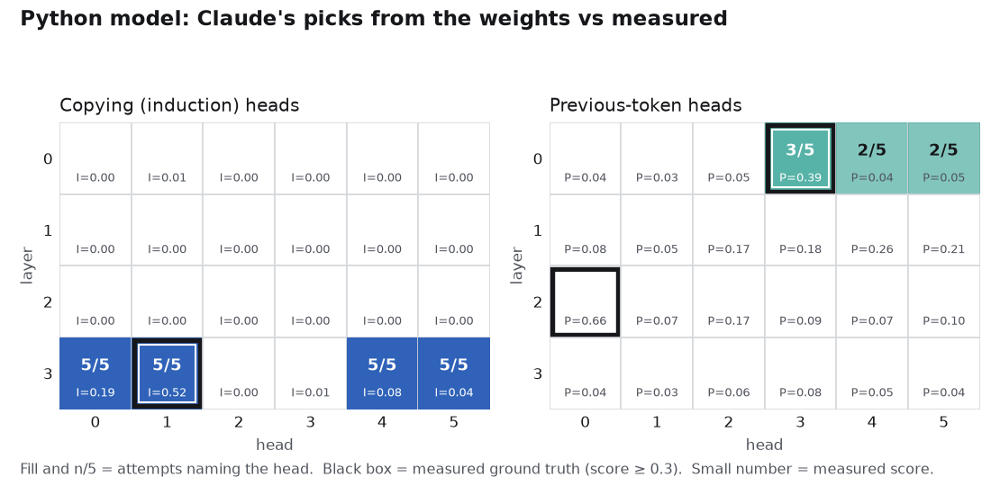
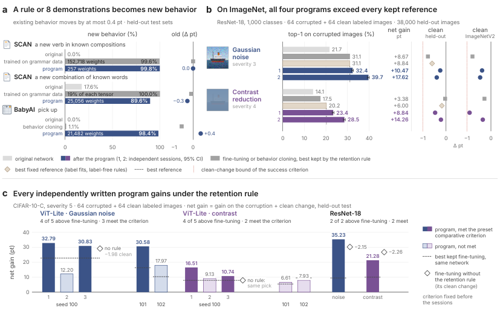
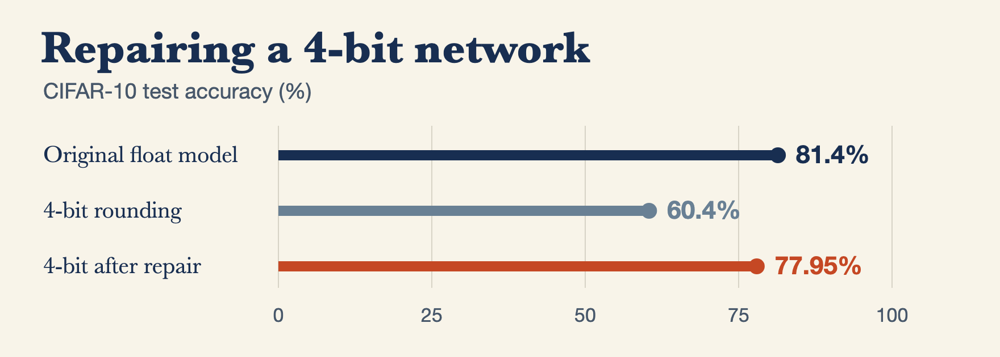
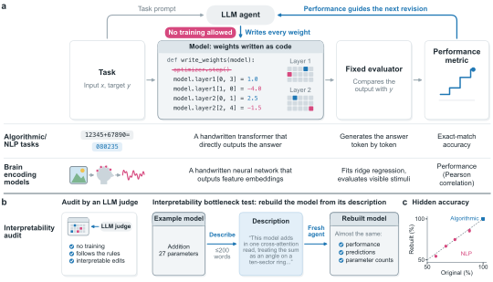

<h1 align="center">
  
</h1>

  <a href="#start-here">Start here</a> &nbsp;·&nbsp;
  <a href="#papers-by-direction">Papers by direction</a> &nbsp;·&nbsp;
  <a href="STUDIES.md">Full index</a> &nbsp;·&nbsp;
  <a href="references.bib">BibTeX</a>

In **weight-space programming**, an agent can read a neural network’s parameters, repair a checkpoint or write the weights of a new network from scratch. Explore **37 studies**, with links to code, checkpoints and experimental controls.

## Start here

**Sparks of Weight-Space Programming** · *Read and edit a checkpoint* 
Takehi and colleagues gave an agent access to neural weights. In the Qwen experiment, the agent could also run Python and inspect forward passes. The logs let you trace how it found an edit that reduced repeated reasoning. [Article](https://rikiyat.github.io/blog/weight-space-programming/) · [Experiment logs](https://github.com/RikiyaT/lm_understand-logs) · [Edited checkpoint](https://huggingface.co/RikiyaT/Qwen3.5-0.8B-weight-space-programming)

**LoopedWSP** · *Write a network from scratch* 
A coding agent sets the weights of a small transformer so one pass through its shared block advances a maze search. Follow a single cell through that update, then inspect the matrices that make the solver work. [Walkthrough](https://mbzuai-oryx.github.io/LoopedWSP/) · [Prompts](https://github.com/mbzuai-oryx/LoopedWSP/tree/main/prompts) · [Weights](https://github.com/mbzuai-oryx/LoopedWSP/tree/main/weights)

**WeightBench** · *Test where the method breaks* 
The benchmark spans 42 tasks. Try comparing the same agent on two of them, such as recognizing a policy from its weights and deciding whether a requested edit is possible. The task registry spells out what the agent can see. [Paper](https://arxiv.org/abs/2611.18553) · [Evaluation harness](https://github.com/Aayush-Marasini/WeightBench)

## Papers by direction

[Reading weights](#reading-weights) · [Editing checkpoints](#editing-checkpoints) · [Writing networks](#writing-networks) · [Control and scientific applications](#control-and-scientific-applications) · [Benchmarks](#benchmarks)

### Reading weights

- **Same Fix, Different Weights.** Can an agent locate the attention head that copies an earlier token? Kundu compares the heads Claude named from weights alone with heads identified by measuring the network. [Paper](https://arxiv.org/abs/2611.20953v1) · [Replication code](https://github.com/Cenrax/weight-space-programming-claude)
- **Auditing zero-shot weight reading.** Ahmed permutes the labels of a CIFAR-10 classifier. The reader still detects a split between output units, but assigns familiar class names to the wrong indices. [Paper](https://arxiv.org/abs/2611.08070)
- **Replicating and Extending Weight-Space Programming.** On three newly designed games, readers often recovered where objects appeared on the board. Inferring the game rules from policy weights proved harder. [Paper](https://arxiv.org/abs/2611.21449v1)

*Figure 5 · Subham Kundu.* Black outlines mark measured heads. In the left panel, Claude named head 3.1 in all five attempts, but also named several heads outside the outline. [Original figure](https://arxiv.org/html/2611.20953v1#S5.F5) · [CC BY 4.0](https://creativecommons.org/licenses/by/4.0/)

### Editing checkpoints

- **WeightCode.** A frozen LLM writes a program that reads an existing network and computes an update. The authors rerun that program on independently trained vision models to test whether the procedure transfers. [Paper](https://arxiv.org/abs/2611.25476) · [Code](https://github.com/Gen-Verse/WeightCode)
- **WSP-Scope.** Six of 16 editing searches kept the original checkpoint. The authors also test successful patches on tasks outside the editing objective, giving a view of both search reliability and transfer. [Paper](https://arxiv.org/abs/2611.09382) · [Experiments](https://github.com/WSP-Scope/WSP-Scope-Project)
- **Self-WSP.** A small Qwen model proposes changes to its own weights and continues as editor after each accepted change. Random search sometimes produces comparable gains, making it an important control. [Paper](https://arxiv.org/abs/2611.28833v1)

*Figure 2 · Bo Li et al.* Start with panel **a**. The bars show performance on the new behavior. The dots beside them show how much the same edit changed performance on previously learned tasks. [Original figure](https://arxiv.org/html/2611.25476v1#S4.F2) · [CC BY-SA 4.0](https://creativecommons.org/licenses/by-sa/4.0/)

Worked example · Repairing a 4-bit image classifier

Rounding this image classifier’s weights to four bits cost **21 percentage points** of accuracy. Given the original and rounded weights as text, Opus 5.5 adjusted the rounding one layer at a time and recovered **17.55 points**. The model had no images, tools or inference calls during the repair. [Steffen Urban, November 2026](https://arxiv.org/abs/2611.33031v1) · [Code and prompts](https://github.com/urbste/weight-space-programming-ptq)

### Writing networks

- **Interpretable weight-space programming (iWSP).** An agent writes a network in code, evaluates it, and revises its construction. A second experiment asks whether another agent can rebuild the model from a short description. [Paper](https://arxiv.org/abs/2611.18114) · [Code and logs](https://github.com/csinva/weight-space-programming-autoresearch)
- **LoopedWSP.** The released maze solver encodes a search update in a transformer block. Inspect the matrices alongside the prompt to see what the programmer supplied and which computation repeats at inference. [Walkthrough](https://mbzuai-oryx.github.io/LoopedWSP/) · [Written weights](https://github.com/mbzuai-oryx/LoopedWSP/tree/main/weights)
- **Compiling Known Rules into Compact Neural Agents.** Given simulator source for previously unpublished games, the strongest writer solved 56% of held-out levels with a fixed network and feedback. Python players written by the four main models solved 97–100%. [Paper](https://arxiv.org/abs/2611.16981v1) · [Games and code](https://github.com/JensLehmann/weight-space-programming-games)

*Figure 1 · Yash Mehta et al.* Follow the validation score back to the writer in panel **a**. Panel **b** asks how much of the model’s behavior survives when a fresh agent rebuilds it from at most 200 words. [Original figure](https://arxiv.org/html/2611.18114v1#S1.F1) · [CC BY 4.0](https://creativecommons.org/licenses/by/4.0/)

### Control and scientific applications

- **Tractor guidance.** Two agents wrote or repaired a 253-parameter steering controller using simulated feedback. The authors then measured tracking error on a real tractor against a classical pure-pursuit controller. [Paper](https://arxiv.org/abs/2611.21958v1)
- **Physics2Weight.** A programmer builds networks from equations and boundary conditions. On nonlinear problems, the predicted solution can look accurate while still leaving a sizable residual in the governing equation. [Paper](https://arxiv.org/abs/2611.12954)
- **Weight-space programming for medical imaging.** Two agents wrote small CNNs without seeing an image. Training the same architecture on 256 labeled images gave higher AUC on each of the six MedMNIST tasks. [Paper](https://arxiv.org/abs/2611.12066v1) · [Weights and protocol](https://github.com/MaximilianLindholz/weight-space-programming-medical)

*Figure 5 · Timo Oksanen.* Each row shows all 253 parameters. On the left, the two agents starting from zero used only 53 and 50 nonzero weights. On the right, follow the two repairs from their shared, densely populated starting checkpoint. [Original figure](https://arxiv.org/html/2611.21958v1#S4.F5)

### Benchmarks

- **WeightBench.** Its 42 tasks span reading, repair, construction, impossible edits and data-free compression. Per-track results show which operations drive an aggregate score. [Paper](https://arxiv.org/abs/2611.18553) · [Task registry](https://github.com/Aayush-Marasini/WeightBench)
- **IWIBench.** A validator reapplies the proposed patch to a clean model and measures both the requested behavior and retention of other abilities. The benchmark covers ten text-editing objectives. [Paper](https://arxiv.org/abs/2611.08647)

Inspect the WeightBench evaluation pipeline

*Figure 1 · Aayush Marasini, Barsat Khadka and Nick Rahimi.* Follow the probe results back to the research agent, then follow the final submission to the held-out evaluator. The two paths show which feedback is available while constructing an edit. [Original figure](https://arxiv.org/html/2611.18553v1#S3.F1)

For earlier work on compiling programs into weights, see [Tracr and AdderBoard](STUDIES.md#foundations). The [full research index](STUDIES.md) includes further replications, scientific applications and evaluation controls.

## Contributing

To suggest a study, add it to the [research index](STUDIES.md) and [bibliography](references.bib) in a pull request. Describe what the programmer could observe, which weights changed and how the authors tested the result.
