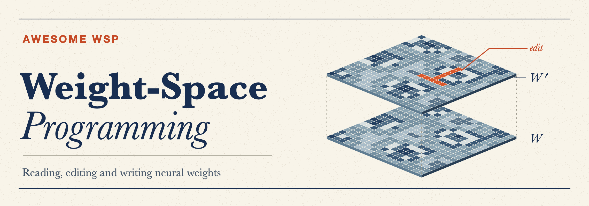

<h1 align="center">
  
</h1>

  <a href="#start-here">Start here</a> &nbsp;·&nbsp;
  <a href="STUDIES.md">Research index</a> &nbsp;·&nbsp;
  <a href="#a-weight-edit-in-practice">Example edit</a> &nbsp;·&nbsp;
  <a href="references.bib">BibTeX</a>

In **weight-space programming**, an agent can read a neural network’s parameters, repair a checkpoint or write the weights of a new network from scratch. Explore **37 studies**, with links to code, checkpoints and experimental controls.

## Start here

**Sparks of Weight-Space Programming** · *Read and edit a checkpoint* 
Takehi and colleagues gave an agent access to neural weights. In the Qwen experiment, the agent could also run Python and inspect forward passes. The logs let you trace how it found an edit that reduced repeated reasoning. [Article](https://rikiyat.github.io/blog/weight-space-programming/) · [Experiment logs](https://github.com/RikiyaT/lm_understand-logs) · [Edited checkpoint](https://huggingface.co/RikiyaT/Qwen3.5-0.8B-weight-space-programming)

**LoopedWSP** · *Write a network from scratch* 
A coding agent sets the weights of a small transformer so one pass through its shared block advances a maze search. Follow a single cell through that update, then inspect the matrices that make the solver work. [Walkthrough](https://mbzuai-oryx.github.io/LoopedWSP/) · [Prompts](https://github.com/mbzuai-oryx/LoopedWSP/tree/main/prompts) · [Weights](https://github.com/mbzuai-oryx/LoopedWSP/tree/main/weights)

**WeightBench** · *Test where the method breaks* 
The benchmark spans 42 tasks. Try comparing the same agent on two of them, such as recognizing a policy from its weights and deciding whether a requested edit is possible. The task registry spells out what the agent can see. [Paper](https://arxiv.org/abs/2611.18553) · [Evaluation harness](https://github.com/Aayush-Marasini/WeightBench)

## A weight edit in practice

Rounding this image classifier’s weights to four bits cost **21 percentage points** of accuracy. Given the original and rounded weights as text, Opus 5.5 adjusted the rounding one layer at a time and recovered **17.55 points**. The model had no images, tools or inference calls during the repair. [Steffen Urban, November 2026](https://arxiv.org/abs/2611.33031v1) · [Code and prompts](https://github.com/urbste/weight-space-programming-ptq)

## Browse the collection

| Research question | Where to look |
| --- | --- |
| What can you infer from the weights alone? | [Reading weights](STUDIES.md#reading-weights) · [Replications and controls](STUDIES.md#replications-and-controls) |
| Can a capability be repaired or transferred? | [Editing checkpoints](STUDIES.md#editing-checkpoints) · [Language and vision models](STUDIES.md#editing-language-and-vision-models) |
| What can a programmer build from a specification? | [Writing networks](STUDIES.md#writing-networks) · [Control, games and verification](STUDIES.md#control-games-and-verification) |
| Which gains hold up against a baseline? | [Benchmarks](STUDIES.md#benchmarks) · [Scientific and decision systems](STUDIES.md#scientific-models-and-decision-systems) |
| How do you compile a known algorithm into weights? | [Tracr and AdderBoard](STUDIES.md#foundations) |

## Contributing

To suggest a study, add it to the [research index](STUDIES.md) and [bibliography](references.bib) in a pull request. Describe what the programmer could observe, which weights changed and how the authors tested the result.
